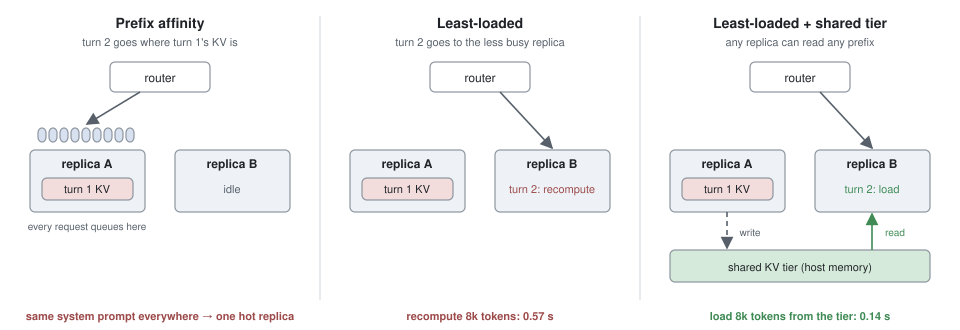
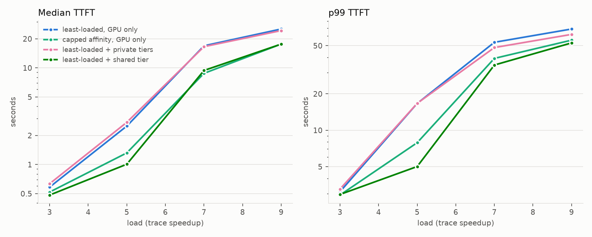
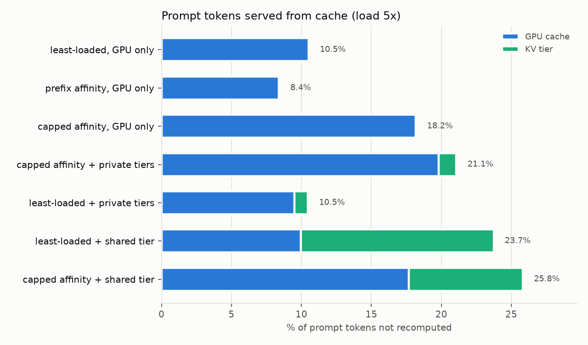
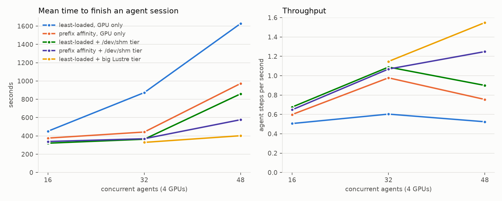

# kv-anywhere

Route LLM requests by load and let a shared KV tier supply the cached prefix, instead of routing each request to the replica that already caches it. 4 vLLM replicas on NERSC Perlmutter A100s, replaying real chat and coding-agent traces.

## The idea

When several replicas serve one model, each keeps its own prefix cache on the GPU. The second turn of a conversation is cheap only if it lands on the replica that served the first turn, because that replica still has the first turn's KV. So routers usually send each request to the replica caching the longest part of its prompt (*prefix affinity*). That fights with load balancing.

DeepSeek's inference system (DeepInfer, 2026) does the opposite: its KV cache lives on a storage cluster that every engine can read, and "since any engine can hit any prefix, there is no prefix-affinity routing." This repo tests that choice at small scale.



- **Prefix affinity** keeps a conversation on one replica. But every conversation in a real trace starts with the same system prompt, so one replica always has the longest match.
- **Least-loaded** balances well, but the second turn usually lands on a replica that has to recompute the whole conversation so far.
- **Least-loaded + shared tier** balances like least-loaded and still reuses the first turn: replica B loads A's KV instead of recomputing it, about 4x faster.

Affinity brings the request to its cache. A shared tier brings the cache to the request.

Two variants separate the effects: *capped affinity* (affinity only among replicas within 16k pending tokens of the least loaded one, like SGLang's balance threshold) and *private tiers* (the same tier capacity, split per replica, so "more cache" is tested apart from "shared cache").

## How it works

- **Replicas.** 4 × vLLM (Qwen2.5-7B-Instruct), one per A100-40GB, each with its usual GPU prefix cache (about 380k tokens).
- **Shared tier.** vLLM's `OffloadingConnector` with a file-system tier in `/dev/shm`, the same directory for all four replicas. A block's file name is a hash of its tokens, so a replica finds blocks that another replica wrote. `gc.py` keeps the tier under 100 GB (1.7M tokens) by deleting the oldest blocks, a simpler version of DeepSeek's GC worker.
- **Router.** `router.py`, a small proxy. It can't see inside the replicas, so it keeps its own guess of each one (prefill tokens sent but not yet answered, and the prompt blocks it sent there) and picks a replica with a policy from `policies.py`.
- **Workload.** The Mooncake *conversation* trace (Kimi, FAST'25): an hour of real requests, each listing hash ids for its 512-token blocks. `trace.py` turns each hash id back into a fixed block of random tokens, so replayed prompts share exactly what the real ones shared. A 4-GPU cluster can't hold thousands of live conversations, so it keeps 30% of the *conversations* (each one whole) from a 10-minute window: 481 requests, mean prompt 9.3k tokens, mean output 355. Time is compressed to set the load: "5x" plays the 10 minutes in 2.
- **Clean runs.** Before every run the GPU caches, CPU caches, tier files and the router's guesses are all cleared.

## Results



At 5x, where GPU-only least-loaded starts to saturate:

| Design | p50 TTFT | p99 TTFT | Prompt tokens from cache |
|---|---|---|---|
| Least-loaded, GPU only | 2.5 s | 16.7 s | 10.5% |
| Prefix affinity, GPU only | 217 s | 449 s | 8.4% (all 481 requests on one replica) |
| Capped affinity, GPU only | 1.3 s | 7.9 s | 18.2% |
| Least-loaded + private tiers | 2.7 s | 16.7 s | 10.5% |
| Capped affinity + private tiers | 1.1 s | 5.8 s | 21.1% |
| **Least-loaded + shared tier** | **1.0 s** | **5.0 s** | **23.8%** |
| Capped affinity + shared tier | 0.9 s | 4.8 s | 25.8% |

- **With a shared tier, routing by load alone beats every GPU-only policy.** It cuts p99 TTFT 3.3x versus least-loaded and beats capped affinity, without the router knowing anything about prefixes.
- **Pure prefix affinity collapses.** All 481 requests go to one replica, at every load.
- **Sharing matters, not capacity.** Private tiers with the same 100 GB add nothing for least-loaded: a conversation's next turn usually lands on a different replica, whose private tier doesn't have it.
- **Affinity on top of the shared tier helps a little** (p99 4.8 vs 5.0 s). Once any replica can load any prefix, keeping a conversation in place saves a 0.1–0.2 s copy, not a recompute.
- Above 7x every design is overloaded; the shared tier still has the lowest TTFT.



### A different workload: tool agents

The Mooncake *toolagent* trace (same sampling: 1,039 requests) is the opposite case. Most reuse is three system prompts shared by thousands of short sessions, and every replica keeps those on its GPU anyway, so even least-loaded serves 45% of prompt tokens from cache.

| At 5x | p50 TTFT | p99 TTFT | From cache |
|---|---|---|---|
| Least-loaded, GPU only | 2.0 s | 13.2 s | 45.2% |
| Prefix affinity, GPU only (run at 2x only) | 26 s | 220 s | 45.9% (two hot system prompts → two busy replicas, two idle) |
| Capped affinity, GPU only | 0.44 s | 3.5 s | 51.8% |
| **Least-loaded + shared tier** | **0.37 s** | **3.6 s** | **54.7%** |

Here capped affinity is a strong GPU-only policy, and the shared tier matches it rather than beating it. In both traces, load-only routing plus a shared tier is as good as or better than the best GPU-only policy, without the router knowing anything about prefixes.

### What decides the payoff: KV bytes per token

The same conversation sweep with Qwen3-8B, which stores 2.6x more KV per token than Qwen2.5-7B (147 KB vs 57 KB):

| | Qwen2.5-7B | Qwen3-8B |
|---|---|---|
| KV per GPU | 382k tokens | ~140k tokens |
| 100 GB tier | 1.7M tokens | 0.68M tokens |
| Loading vs recomputing a prompt | 5x cheaper | 2x cheaper |
| From cache, least-loaded → + shared tier | 10.5% → 23.8% | 6.4% → 14.8% |
| p99 TTFT at the knee (5x / 3x), least-loaded → + shared tier | 16.7 s → 5.0 s (3.3x better) | 12.5 s → 9.6 s (1.3x better) |

Bigger KV hurts the shared tier three ways: each tier load moves more bytes, the tier holds fewer tokens, and the GPU holds fewer requests at once, so the cluster saturates sooner. A shared tier pays off in proportion to how much cheaper it is to load a token's KV than to recompute it. DeepSeek notes that V4.1 "compresses the KV cache substantially", which is part of what makes their design work.

3 of the 13,468 requests in the main sweep failed with a dropped keep-alive connection between the router and vLLM; the router now retries those.

## Long-horizon agents

Chat is the easy case. A coding agent runs dozens of steps, each step's prompt is the previous prompt plus one tool result, and the context grows past 100k tokens. That changes the calculus:

| | Conversation | Agent session |
|---|---|---|
| Context per request | ~9k tokens | median ~57k, up to 128k (longer sessions exist; we keep ≤128k) |
| Shared with the previous request | partial | 99.6% (median) |
| Cost of a cache miss | 0.57 s (8k tokens) | 24 s (120k tokens) |
| KV per session | ~0.5 GB | 3–7 GB, so a GPU holds ~3–7 sessions |
| Gap between requests | user think time | tool runs: median 1.7 s |

**Workload.** FreeInference (Harvard, CC-BY-4.0) logs production coding agents (codex, opencode, ...) with session ids, start/end times, and ids for every 16-token block of every prompt. `agents.py` keeps sessions whose context peaks between 32k and 128k tokens (one day: 117 sessions, median 34 steps), regroups the block ids into the same 512-token chained ids, and replays them *closed loop*: an agent sends its next step only when the previous one finishes, plus the recorded tool gap (capped at 30 s). Each session runs its first 30 steps, with outputs capped at 256 tokens. The load knob is the number of concurrent agents. Serving uses Qwen2.5-7B with its 128k-context (YaRN) setting.

**Where the tier lives.** The shared tier is either node-local memory (`/dev/shm`) or Lustre (Perlmutter's `$SCRATCH`), a distributed file system every node can read, like DeepSeek's storage cluster in miniature. For a 120k-token prompt:

| Recompute | Load from `/dev/shm` | Load from Lustre |
|---|---|---|
| 24 s | 1.7 s | 3.3 s |



At 48 agents (4 GPUs):

| Design | Session time | Throughput (steps/s) | p99 TTFT |
|---|---|---|---|
| Least-loaded, GPU only | 1628 s | 0.52 | 52 s |
| Prefix affinity, GPU only | 973 s | 0.75 | 53 s |
| Least-loaded + `/dev/shm` tier (100 GB) | 859 s | 0.90 | 46 s |
| Prefix affinity + `/dev/shm` tier (100 GB) | 577 s | 1.25 | 41 s |
| Least-loaded + Lustre tier (100 GB) | 836 s | 0.92 | 48 s |
| **Least-loaded + Lustre tier (2 TB, nothing evicted)** | **402 s** | **1.55** | **16 s** |

- **Without a tier, affinity flips from worst to best.** In chat it collapsed onto one replica. Here each session's own long prefix decides the match, so affinity just keeps a session where its KV is, and a miss costs a full 100k-token recompute. Least-loaded on GPUs alone recomputes constantly (16% hits).
- **A small tier helps, but eviction gets in the way.** At 48 agents the sessions' KV no longer fits in 100 GB. `gc.py` deletes the *oldest-written* blocks (tmpfs doesn't record reads), and for agents that is the worst choice: every session's oldest blocks are the head of its prompt, and a prefix match stops at the first missing block, so evicting the head throws away the whole session. The model shows this directly: with oldest-first eviction it reproduces the measured hit rate (65.1% vs 65.6%); with least-recently-used eviction, which is what DeepSeek's GC does, it predicts 79%. Affinity hides the problem by keeping most hits on the GPU.
- **Capacity beats distance.** Lustre is 2x slower per load, and with the same 100 GB it performs like `/dev/shm`. With 2 TB, nothing is evicted, and plain least-loaded routing becomes the best design by far: 4x faster sessions and 3x the throughput of the GPU-only baseline. With enough storage, DeepSeek's "no prefix-affinity routing" wins for agents too.

So the agent version of the story: the tier stops being an optimization and becomes the thing that decides how many agents a GPU can serve, and what matters most about it is that it's big enough to never evict a live session.

All 22,820 agent requests succeeded. The simulator (below), given the long-context calibration and recorded tool gaps, predicts mean session time within 3% (median) and 23% (worst) across the 25 runs it wasn't fitted on. Its predictions for the other arms were saved while the sweep was still running (`results/agents_predictions.json`), and it predicted about 380 s at 48 agents for the 2 TB tier before those runs (measured: 402 s).

## Why: a step-by-step model of a replica

`calibrate.py` measures one replica in isolation:

| Qwen2.5-7B on one A100 | |
|---|---|
| Recompute a prompt | 59 µs per token, plus attention over the context |
| Load it from the shared tier | 12 µs per token (5x cheaper) |
| One decode step | 12.4 ms + 29 ns per token of context in the batch |

The decode step is the weights read once (15 GB at ~1.5 TB/s ≈ 10 ms) plus every running request's KV (57 KB per token). Prefill is limited by compute and decode by memory bandwidth, and a busy replica does both in every step.

`sim.py` replays the same trace through these costs, stepping each replica the way vLLM does: every running request decodes one token per step, the rest of the 2048-token step budget goes to prefill chunks, and a request starts only once its KV fits. The routers and caches are the same code as the real ones (`policies.py`).

One extra number, a 1.2x slowdown for what a loaded server adds on top of isolated requests (scheduler and API-server CPU, mixed batches), is fitted on one arm (GPU-only least-loaded). With it fixed, the model predicts the other six arms:

- hit rates within 3.3 points;
- TTFT typically within 10–20%, but off by up to 1.6x at 7x, right at the knee, where small errors in capacity turn into large errors in queueing;
- at every load, a shared-tier design is the best one, as measured.

The same procedure on the other sweeps, each with its own calibration, fits a similar slowdown (1.18 for toolagent, 1.13 for Qwen3-8B, 1.10 for agents) and predicts hit rates within 4 points. Two things the model needed to match reality: tier copies queue on each replica's host link, and the tier evicts oldest-written blocks first, like `gc.py`. One thing it misses: pure affinity on toolagent. Which replica a hot system prompt sticks to depends on where its first request happens to land; the real run put two of the three prompts on one replica, the model spread them across three.

```
python3 validate.py results/conv_qwen25 --calib results/calib_qwen25/calib.json \
    results/decode_Qwen2.5-7B-Instruct/calib.json --kv-bytes 57344
```

## Running it (Perlmutter)

```
bash perlmutter/launch.sh 03:00:00 perlmutter/jobs/conv_qwen25.sh   # one 4-GPU node, ~2 node-hours
python3 analyze.py results/conv_qwen25                              # one row per run
python3 figures.py results/conv_qwen25 --speed 5
python3 docs/make_diagram.py

bash perlmutter/launch.sh 01:30:00 perlmutter/jobs/agents_pilot.sh  # 128k calibration, both tiers
bash perlmutter/launch.sh 04:00:00 perlmutter/jobs/agents_gpu.sh    # also agents_shared, agents_lustre, agents_lustre_big
python3 validate.py results/agents_qwen25 --calib results/calib_agents/calib_shared.json \
    --calib-lustre results/calib_agents/calib_lustre.json --kv-bytes 57344
python3 figures.py results/agents_qwen25 --agents
```

`perlmutter/run.sh` expects a vLLM venv (`$SCRATCH/vllm-dev/env.sh`) and models in `$SCRATCH/huggingface`. Everything for one node runs from a single `srun`, because Slingshot allows only 3 network applications per node.

| File | What it is |
|---|---|
| `trace.py` | Mooncake trace → conversation-sampled workload → token ids with the trace's prefix sharing |
| `agents.py` | FreeInference agent trace → closed-loop agent sessions with the same prefix structure |
| `policies.py` | Routing policies and the router's guess of each replica |
| `router.py` | The routing proxy in front of the replicas |
| `replay.py` | Sends the trace at its arrival times; records TTFT and each replica's cache hits |
| `sweep.py` | Starts 4 replicas per server config and runs every policy × load |
| `gc.py` | Keeps the KV tier under its size budget, oldest blocks first |
| `calibrate.py` | Measures prefill, tier-load, and decode-step costs on one replica |
| `sim.py`, `validate.py` | The step-by-step model and its check against a sweep |
| `analyze.py`, `figures.py`, `docs/make_diagram.py` | Tables and figures |
